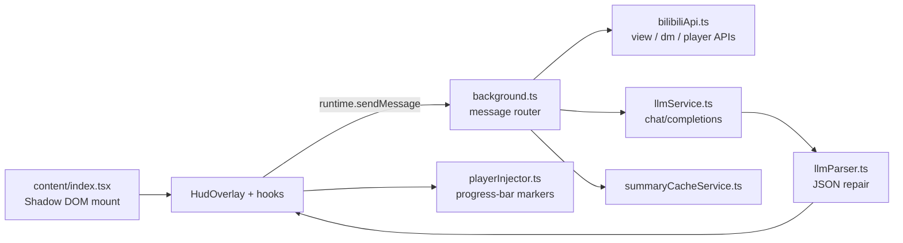

# Repository Guidelines

BiliFlow (极速心流) is a browser extension (Chrome MV3 / Firefox MV2) that adds a keyboard-first AI HUD to Bilibili video pages: it resolves the current video, fetches its subtitles, asks a user-configured OpenAI-compatible LLM for a structured summary, and renders timestamped highlights as an overlay plus markers on the native progress bar. BYOK: keys and summaries live only in `browser.storage.local`.

## Architecture & Data Flow

Three execution contexts, all TypeScript/React:

1. **Content script** (`src/entrypoints/content/`) — mounts a React tree inside a Shadow DOM (`createShadowRootUi`, `cssInjectionMode: 'ui'`) so Bilibili CSS cannot leak in. Owns HUD state, keyboard handling, fullscreen re-parenting, and timeline markers.
2. **Background service worker** (`src/entrypoints/background.ts`) — the only place allowed to make cross-origin calls; holds API keys from storage, proxies Bilibili + LLM requests, and routes every message.
3. **Extension pages** (`src/entrypoints/options/`, `src/entrypoints/popup/`) — settings UI; write to `storage.local`, and broadcast changes that content scripts pick up without reload.



Summary path: `useAutoSummary` extracts `bvid`/`pIndex` from the DOM (`playerController.extractVideoMeta`) → `RESOLVE_VIDEO_INFO` → `bilibiliApi` resolves `cid`/`duration` → cache hit returns immediately → otherwise `FETCH_SUBTITLES` (waterfall: `x/v2/dm/view` → `x/player/v2` → `x/player/wbi/v2`) → `subtitleUtils.selectPreferredSubtitleTrack` + `fuseSubtitles` → `transcriptChunker` (uniform downsampling to a token budget) → `GENERATE_SUMMARY` → `llmService` (primary model, then `fallbackModel`, then `failoverPriorityIds`) → `parseLLMSummaryOutput` → `VideoSummaryResult` cached and rendered.

### Cross-context contracts

- Every message is `ExtensionMessage<T>` with a `type` from the `MessageType` union in `src/types/index.ts`; every reply is `ExtensionResponse<T>` (`{ success, data?, error? }`). Add a new type there and handle it in `handleMessage` in `background.ts` — never call external APIs directly from a content script.
- Content-side sends go through `safeSendMessage` (see `useAutoSummary.ts`) because an extension update invalidates the context and throws `Extension context invalidated`.
- SPA route changes are detected by wrapping `history.pushState`/`replaceState` both in the isolated world and via an injected main-world bridge (`src/utils/spaNavigation.ts`), which re-emits `biliflow:spa-navigate`; `biliflow:ensure-mount` asks the content script to re-attach the HUD host. A 1s heartbeat in `content/index.tsx` recovers from Bilibili destroying the container.
- **Native note boundary**: Bilibili's `.ql-editor` exists only while the note drawer is open. Text "记入笔记" actions go to `noteSyncQueueService` (local-first pending queue, `pending → injected → synced` tombstones, 100 items/video, text-only HTML) and are replayed by `noteSyncReplay.ts`'s `MutationObserver` when `.ql-editor` mounts. Cloud sync still requires the drawer; the queue prevents false failures and data loss, not offline cloud writes. Screenshots always use Bilibili's native camera button + CDN, never local storage, so that path requires an already-open drawer. `setNoteSyncVideoKey()` publishes the API-resolved `cid` (the DOM meta leaves `cid` empty).

## Key Directories

| Path | Purpose |
| --- | --- |
| `src/entrypoints/` | WXT entry points: `background.ts`, `content/`, `options/`, `popup/` |
| `src/entrypoints/content/hooks/` | Lifecycle logic: `useAutoSummary`, `useSettings` (subscribes via `subscribeSettingsChange`), `useVideoController`, `useFullscreenDetector` (global keydown + shortcut matching), `useAnnotations` |
| `src/services/` | Domain + network layer: `bilibiliApi`, `llmService`, `settingsService`, `summaryCacheService` (LRU, max 100), `annotationService`, `noteSyncQueueService` (local-first note replay queue) |
| `src/utils/` | Pure helpers and DOM controllers: `subtitleUtils`, `transcriptChunker`, `llmParser`, `timeParser`, `timelineCalculator`, `playerController`, `playerInjector`, `spaNavigation`, `biliNote*`, `exportUtils` |
| `src/types/` | Data contracts: `index.ts` (messages, summary, providers), `settings.ts` (flags + `UserSettings`), `biliNote.ts` |
| `src/constants/index.ts` | `DEFAULT_PROVIDERS` (9 built-in vendors) and `DEFAULT_SETTINGS` |
| `src/components/` | Shared presentational components (`ProviderIcons`, `ToggleSwitch`, `SliderInput`) |
| `src/public/` | Runtime assets only: `icons/`, provider `logos/` |
| `assets/screenshots/` | Store promo screenshots; stripped from builds by `excludeScreenshotsPlugin` in `wxt.config.ts` |
| `tests/` | Vitest suites, flat `*.test.ts` |
| `scripts/` | Release tooling (`bump-version.mjs`, `publish-edge.mjs`) |
| `.agents/` | Project rules (`rules/`), specs (`specs/`), skills (`skills/`) |
| `docs/` | Historical phase specs (`PHASE_1_SUMMARY.md` … `PHASE_4_SPEC.md`) |

## Development Commands

```bash
npm ci                # postinstall runs `wxt prepare` (generates .wxt/ types)
npm run dev           # WXT dev server, HMR, loads extension
npm run build         # production build → .output/chrome-mv3
npm run typecheck     # wxt prepare && tsc --noEmit
npm run test          # vitest run
npm run test:watch    # vitest watch
npx vitest run tests/timeParser.test.ts   # single suite
npm run zip:all       # .output/biliflow-<version>-{chrome,firefox}.zip + sources.zip
```

No lint or format script exists (no ESLint/Prettier/Biome); `npm run typecheck` is the static gate.

## Code Conventions & Common Patterns

- **Formatting**: 2 spaces, single quotes, semicolons, trailing commas in multiline literals. Match surrounding code; there is no auto-formatter to defer to.
- **Naming**: PascalCase for components (`HudOverlay.tsx`, `HighlightItemCard.tsx`), `useXxx` for hooks, camelCase for services/utils (`llmService.ts`, `timeParser.ts`). Test files mirror the module under test (`tests/llmParser.test.ts`).
- **Imports**: relative paths only (`../../utils/...`). `@/*` is aliased in `tsconfig.json` and `vitest.config.ts` but **unused** — stay consistent and use relative paths.
- **Language**: identifiers, comments-in-code and commit subjects are English; user-facing strings, prompts, and doc prose are Simplified Chinese. Console logs are prefixed `[BiliFlow]`.
- **Types first (SDD)**: declare interfaces in `src/types/` before implementing; the repo rule is spec-driven — see `.agents/rules/spec-workflow.md`. `strict` is on; avoid `any` except at catch boundaries (`catch (err: any)` then narrow).
- **Errors**: services throw `Error` with Chinese messages; the background catches and returns `{ success: false, error }`; hooks surface `error` state and `onToast` messages. Validate external input defensively (empty subtitles, malformed URLs, truncated LLM JSON).
- **State**: local React state + refs; no Redux/Zustand. Persisted state is `UserSettings` in `storage.local`, always merged against `DEFAULT_SETTINGS` (`settingsService.mergeSettingsWithDefaults`) so new flags get defaults for existing users. Cross-context sync uses `settingsService.subscribeSettingsChange` (storage change events), so options-page edits apply to open video tabs without a reload. Schema migrations run in `browser.runtime.onInstalled`.
- **Async**: `async/await` plus `AbortController` + a monotonic `requestIdRef` to drop stale summary responses after a video switch; timeouts on model-list fetches. Streaming is not used — one non-streaming `chat/completions` call per summary.
- **Performance**: `React.memo` on highlight cards, memoized timeline segment math, cleanup of injected DOM/`setInterval` in `ctx.onInvalidated`.
- **UI isolation**: content-script styles live in `content/style.css` scoped through the shadow root; never style Bilibili's DOM globally. Theme via `themeTransition.ts` and Tailwind `bili.*` colors in `tailwind.config.js`.

## Important Files

| File | Why |
| --- | --- |
| `wxt.config.ts` | Manifest (permissions, hosts, gecko id, icons), srcDir, React module, screenshot-stripping Vite plugin |
| `src/types/index.ts` | `MessageType` union, `ExtensionMessage`/`ExtensionResponse`, `VideoSummaryResult` |
| `src/entrypoints/background.ts` | Single message router + install-time settings migration |
| `src/entrypoints/content/index.tsx` | Content-script bootstrap, Shadow DOM mount, fullscreen/SPA recovery |
| `src/entrypoints/content/HudOverlay.tsx` | HUD composition, selected-highlight state, seek/prev/next handlers, all hooks wired |
| `src/entrypoints/content/hooks/useAutoSummary.ts` | Summary lifecycle, cache lookup, cancellation |
| `src/services/llmService.ts` | `SYSTEM_PROMPT`, `formatBaseUrl`, failover chain, model listing |
| `src/utils/llmParser.ts` | `<think>…</think>` stripping, markdown fence removal, truncated-JSON repair |
| `src/utils/subtitleUtils.ts` | Subtitle track scoring, sentence fusion, quote extraction |
| `src/utils/transcriptChunker.ts` | Chunking/downsampling to the prompt budget |
| `src/services/noteSyncQueueService.ts` | Local-first pending queue: dedup tombstones, body-only deletion on injection, 100 items/video cap, rejects `data:image` HTML |
| `src/utils/noteSyncReplay.ts` | `.ql-editor` mount watcher + single `flushNoteSyncQueue` path; `setNoteSyncVideoKey` publishes the API-resolved `cid` |
| `src/entrypoints/content/hooks/useAnnotations.ts` | Orchestrates text → queue → flush and screenshot → native button |
| `src/entrypoints/options/App.tsx` | Settings shell: provider config, model picker, shortcuts, feature flags, backup/restore tabs |
| `scripts/bump-version.mjs` | Canonical way to change the version |
| `.agents/rules/git-workflow.md` | Commit/tag/release SOP — binding |

## Runtime/Tooling Preferences

- **Runtime**: Node 22 (CI uses `actions/setup-node@v4` with `node-version: 22`); no `engines` field.
- **Package manager**: npm only (`package-lock.json`). Do not introduce pnpm/yarn/bun.
- **Build**: WXT `^0.19.26` over Vite; React 18 + `@vitejs/plugin-react`; Tailwind 3.4.17 via PostCSS; TypeScript `^7.0.2`.
- **Targets**: Chrome MV3 → `.output/chrome-mv3`; Firefox MV2 → `.output/firefox-mv2` (gecko id `biliflow@luckjokerwang`, min Firefox 109).
- **Constraints**:
  - Content scripts: no Node builtins, no `eval`/`new Function` (MV3 CSP), no direct cross-origin fetches — go through the background.
  - Background is an ephemeral service worker: no module-level mutable state relied upon across events; persist to `storage`.
  - Requested permissions are only `storage` plus host permissions; adding a permission requires a `wxt.config.ts` change and store re-review.
  - `.output/`, `dist/`, `.wxt/` are generated — never hand-edit.
  - Firefox min version is 109: avoid newer runtime APIs such as `Promise.withResolvers()` in content scripts.

## Versioning, Commits & Releases

Never hand-edit version numbers and never commit without explicit user approval (`.agents/rules/git-workflow.md`).

- Bump with `npm run bump:patch|minor|major` (`scripts/bump-version.mjs`, supports `--dry-run`); it rewrites `package.json`, `package-lock.json`, `wxt.config.ts` (`manifest.version`), the README badge, `src/entrypoints/options/components/OptionsHeader.tsx`, `src/entrypoints/popup/App.tsx`, and `CHROMEWEBSTORE.md`. The script's header comment still says `options/App.tsx`; the real target is `OptionsHeader.tsx` — trust the code.
- `npm run publish:edge` (`scripts/publish-edge.mjs`) uploads `.output/biliflow-<version>-chrome.zip` to the Edge Add-ons API; needs `EDGE_PRODUCT_ID` / `EDGE_CLIENT_ID` / `EDGE_API_KEY`, normally run by CI.
- Commit format: `type(scope): 中文描述 (vX.Y.Z)` — e.g. `fix(hud): 优化交互体验 (v2.0.24)`.
- Then `git tag -a vX.Y.Z -m "release: vX.Y.Z"`, `npm run zip:all`, and `gh release create` with the three zips. Tag pushes (`v*`) trigger `.github/workflows/publish-firefox.yml` and `publish-edge.yml` (typecheck → test → zip → store publish).

## Testing & QA

- **Framework**: Vitest 3 (`vitest.config.ts`), `environment: 'node'`, `globals: true`; no setup file, no coverage thresholds.
- **Location/style**: flat `tests/*.test.ts`, relative imports into `../src/...`, `describe`/`it`/`expect`, inline fixtures (no fixture directory). Network is stubbed by replacing `global.fetch` with `vi.fn()`; `vi.restoreAllMocks()` in `afterEach`. No DOM test environment — component tests exercise logic, not rendering.
- **Coverage**: services and pure utils are tested (`llmService`, `llmParser`, `subtitleResolution`, `transcriptChunker`, `timelineCalculator`, `timeParser`, `settingsService`, `summaryCacheService`, `annotationService`, `playerController`, `spaNavigation`, `exportUtils`, `biliNoteFormatter`, `shortcutHandler`, `highlightList`). Entry points, hooks, and most React components are **not** covered — verify those manually in a browser via `npm run dev`.
- **Expected gate before delivery**: `npm run typecheck && npm run test`.
- **Edge cases that already have regressions worth preserving**: stale-response cancellation, provider failover on 429/402, truncated LLM JSON repair, `<think>` tag stripping, subtitle track preference order, long-video downsampling budget.
